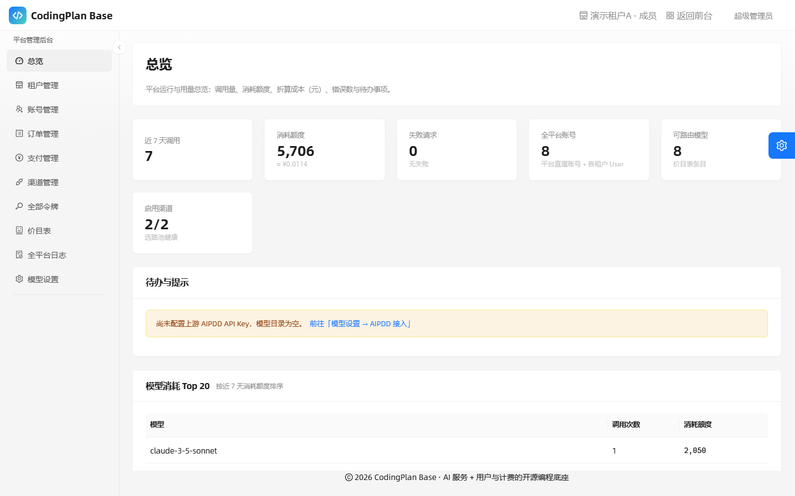
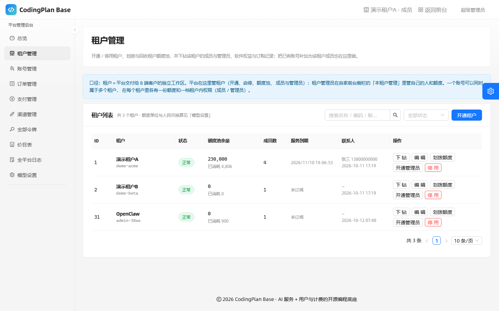
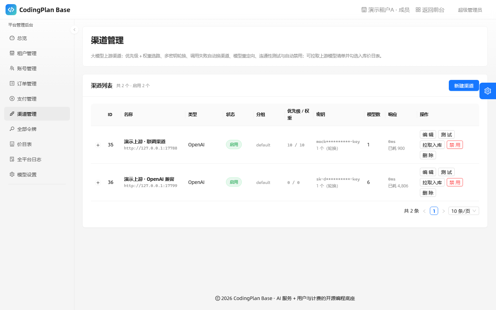
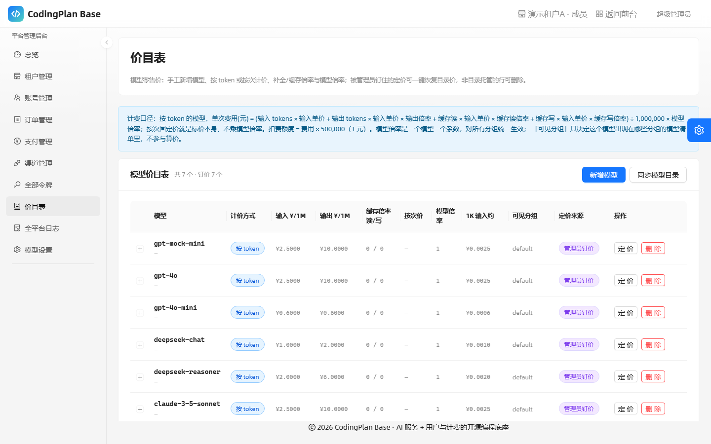
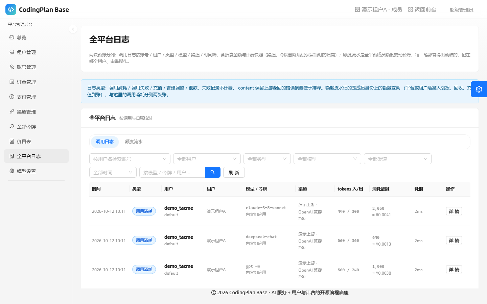
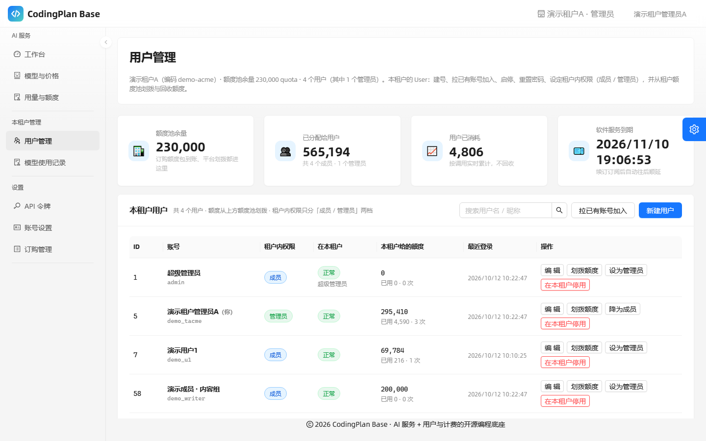
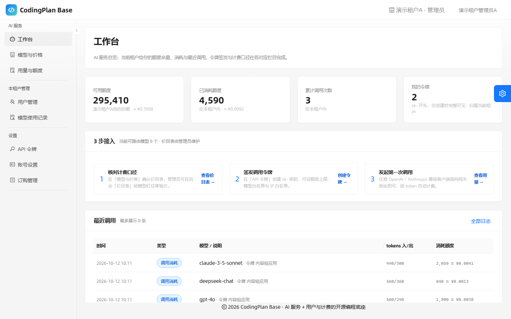
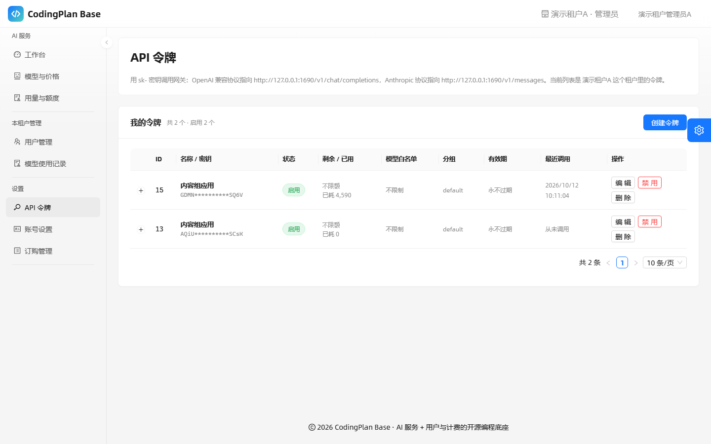
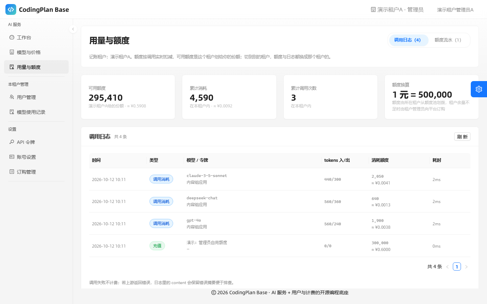
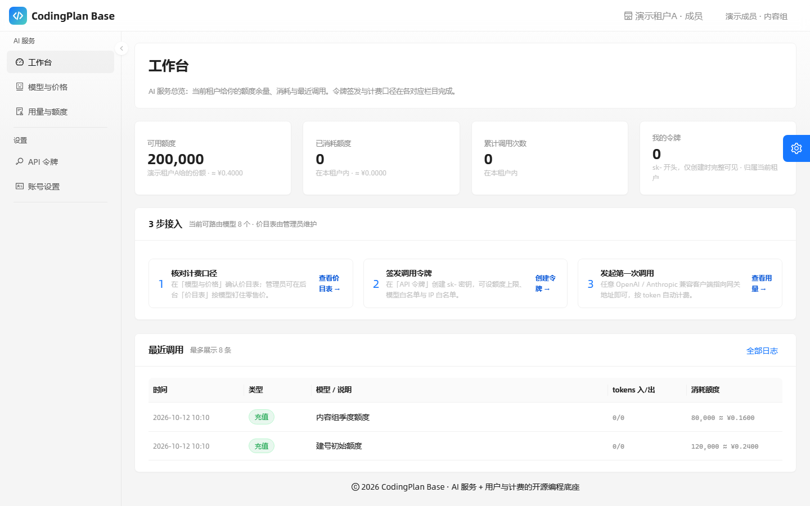

# CodingPlan Base

开源 SaaS 底座：**租户体系 + 分级账号 + AI 服务（大模型网关）+ 按 token 计费 + 可选 B 端支付**。

目标是让你从零起一个可以对外交付的 SaaS 独立站：SQLite 起步零外部依赖，平台方开通租户、租户管理员管自己的人和额度、租户成员签发 `sk-` 令牌调用大模型；一个账号可以同属多个租户，切到哪个租户就用哪个租户的身份与额度；管理员后台粘一次 AIPDD API Key 就能拉全量模型价目表，需要收款时打开 Chandler.work 做订阅与功能买断。业务逻辑一概不预置——你要做的那一层，就长在这个底座上。

- 两个身份轴：**全局身份**决定是不是平台管理员，**租户内权限**决定在某个租户里能管谁；一个账号可在 A 租户当管理员、在 B 租户只是成员。权限由身份决定，界面按身份收口
- 前端 Next.js 16 + React 19 + Ant Design 6，全站走同源 BFF
- 后端 NestJS 11 + Prisma 5 + SQLite（WAL），全局 JWT 守卫；MySQL / PostgreSQL 只需换方言 schema 与 DDL
- 网关兼容 OpenAI `/v1/chat/completions` 与 Anthropic `/v1/messages`
- 计费口径以人民币计：`1 元 = 500000 quota`，支持按 token / 按次、补全与缓存倍率、模型倍率、零售 markup
- 全局身份 `普通用户 1 / 系统管理员 10 / 超级管理员 100`（`0` 是沿用上游的保留常量，不可授予），低角色不能授予高角色；「租户管理员」**不是**全局身份，而是租户内权限 `成员 1 / 租户管理员 5`，记在人与租户的成员关系上

## 底座模型：平台 · 租户 · 成员

租户（Tenant）是平台交付给 B 端客户的一整套独立工作区：自己的成员、自己的额度池、自己的软件权益与订购记录。人和租户是多对多的：同一个人可以是几个租户的成员，每个租户各自给他记一份可用额度，切到哪个租户就以哪个租户的身份调用与记账。平台与租户的职责是**互斥**的，越界动作既不在界面上渲染，也在服务端拒绝。平台侧内部也分层：「模型设置」放着额度换算、零售倍率、上游密钥与开放注册这类平台级参数，只认超级管理员。

```
平台（/admin/*，全局身份 ≥10）          本租户管理（/console/*，本租户权限 5）     前台（所有登录账号，按身份增项）
  ├─ 租户管理 ─ 开通 / 停用租户            ├─ 用户管理 ─ 建号、拉已有账号入驻、    ├─ AI 服务
  │            ─ 额度池划拨与回收          │            启停、改密、设定租户内权限 │   ├─ 工作台
  │            ─ 开通租户管理员账号        │            从额度池划拨 / 回收并留痕  │   ├─ 模型与价格
  │            ─ 下钻成员 / 权益 / 池流水  └─ 模型使用记录 ─ 本租户成员的          │   └─ 用量与额度
  ├─ 账号管理 ─ 全平台账号 + 按租户筛身份  │            调用与额度流水             └─ 设置
  ├─ 订单管理 ─ 全平台订单、退款试算       （上游渠道与批发成本属平台侧，            ├─ API 令牌（签发 sk-）
  ├─ 支付 / 渠道 / 全部令牌 / 价目表 /     │            不在这一层出现）            ├─ 账号设置（改密、我的租户、绑平台账号）
  │            全平台日志                 订购不在这里：见前台「订购管理」        └─ 订购管理 ─ 按当前租户身份：
  └─ 模型设置 ─ 超管专属：换算参数 / 上游                                     本租户管理员＝软件订购 + 订购记录
               接入 / 开放注册                                            平台直属账号＝全平台订购记录，不下单
```

三层不是三套账号：全局身份在 `users.role` 上，租户内权限在 `tenant_members.role` 上（人和租户的多对多，切租户换的就是这一行）。管理员也有前台，但两层的接法不同：**平台侧**是另一棵菜单树，顶栏给「管理后台 / 返回前台」进出；**租户侧**不另开区域、不进顶栏——租户管理员的管理动作就是前台侧栏里多出的那一组「本租户管理」（用户管理 / 模型使用记录），由他**在当前租户里的角色**决定渲不渲染，切到他只是成员的租户就整组消失。双身份账号因此两侧都齐：顶栏一个「管理后台」，侧栏一组「本租户管理」，不存在谁顶掉谁。

四条口径，改代码前先记住：

1. **身份与额度记在成员关系上，不记在账号上**。可用额度、令牌、调用日志、用量都挂在「某个账号在某个租户里」这条 `tenant_members` 记录上：同一个账号在 A 租户可用 5000、在 B 租户可用 777，切到哪个租户就花哪份、账单也落在那个租户。`users` 表只留全局身份与口令，注册后没有可用租户就只能先创建或加入租户。
2. **订单主体是租户**。每一单都是某个租户（下单人为该租户的管理员）向平台购买软件产品或服务，`payment_orders.tenant_id` 是归属主体；租户侧只有「订购管理」（下单 + 只读订购记录），没有订单管理模块，退款只能由平台做。
3. **额度只有一条来路，用完即停**。平台把额度划拨进租户的 `quota_pool`（订购额度包也是到账进池），租户再从池里分配给自家成员的 `tenant_members.quota`；只有平台侧建号 / 补加成员时填的初始额度是直接给到成员的、不动额度池，除此之外平台不给租户成员发额度，租户也不能凭空造额度。当前租户给的那份额度归零后，网关在选路与计费之前直接拒调用（`429 当前租户内额度不足，请联系该租户管理员分配额度`），不限额令牌也照样挡——回收额度＝立刻停用 AI，补充额度＝立刻恢复。
4. **下单必须在租户侧**。Chandler 预支付要求以付款人自己的平台身份发起，平台无法代租户付款，所以收银台在前台「设置 → 订购管理」，而不是平台后台。这个菜单对「当前租户的管理员」和平台管理员 / 超管都渲染（超管 / 平台管理员的前台与租户管理员同款），但平台直属账号没有自己的租户，进去看到的是全平台的「订购记录」，没有「软件订购」页签——服务端同样拒绝它下单。

两个轴的取值与判定：全局身份 `ROLE_GUEST 0`（保留常量）/ `ROLE_USER 1` / `ROLE_ADMIN 10` / `ROLE_ROOT 100`，`isAdmin()` 是 ≥10、`isRoot()` 是 ≥100；租户内权限 `MEMBER_ROLE_USER 1` / `MEMBER_ROLE_ADMIN 5`，`isTenantAdmin()` 是「本次会话有当前租户，且在这个租户里是 5」。「租户管理员」写在 `tenant_members.role` 上——平台可以在「租户管理」开通管理员或补加已有账号，租户管理员也能在建号 / 拉人时指定；旧口径里的 `users.tenant_id` 与「角色 5 必须挂租户」已经随成员表一起退场。当前租户是 JWT 里的 `tenantId` 声明（`0` = 不在任何租户内），每个请求由守卫重新确认一次：令牌里的租户仍是「启用中的成员」就继续用它，被停用或被移除则自动退到这个人的第一个可用租户（一个租户踢人不连带把他的其他租户会话一起打死），全都没有就是无租户视角。切租户＝重新签发令牌，记账口径跟着换。

## 界面一览

下面这些图都是本地演示库里的真实界面：两个本地 mock 上游、7 个钉价模型、3 个租户、8 个账号，跑过几次网关调用。额度、单价、用量全是造的假数据，界面里也不出现任何真实凭据。按「平台 → 租户 → 成员」三层排——同一套组件、同一套口径，差别只在身份。

### 平台侧后台（全局身份 ≥10，`/admin/*`）

平台管的是**供给**：租户、上游渠道、价目表、全平台的账。

**总览** —— 近 7 天调用量、消耗额度折算成元、失败请求、可路由模型数；待办直接链到缺的那一步。



**租户管理** —— 开通 / 停用租户、划拨与回收额度池、下钻成员与权益。列表里 `OpenClaw` 那一行是超级管理员自己创建的租户：人和租户多对多，所以一个账号在几个租户里就各有几份额度。



**渠道管理** —— 多上游：优先级 + 权重选路、多密钥轮换、连通性测试与自动禁用；「拉取入库」把上游的模型清单勾进价目表。密钥列始终是掩码。



**价目表** —— 零售价的三个来源（目录 / 自动 / 管理员钉价）在「定价来源」一列里可读，钉过的可一键回落目录价，只有非目录托管的行才可删。



**全平台日志** —— 调用日志与额度流水两块台账分开记；渠道、令牌删掉之后，日志里仍保留当时的归属。



### 租户管理员的前台（当前租户内权限 5）

租户管的是**自己的人和额度**。管理动作不另开一个区域、也不进顶栏，就是前台侧栏多出来的那一组「本租户管理」。

**本租户管理 → 用户管理** —— 额度池余量 / 已分配 / 用户已消耗三个数一眼对得上；建号、拉已有账号入驻、启停、重置密码、设定租户内权限、从池里划拨与回收。注意第一行：超级管理员在这个租户里也只是「成员」。



**工作台** —— 当前租户给这个账号的份额、已消耗、累计调用与最近日志；「3 步接入」把核对口径 → 签发令牌 → 发起调用串成一条。



**API 令牌** —— `sk-` 只在这次创建时完整可见，列表里只剩首尾掩码；额度上限、模型白名单、IP 白名单都记在「这个账号在这个租户里」这条成员关系上。



**用量与额度** —— 调用日志与额度流水两个页签，右边那个是「谁给这个人拨了多少额度」的台账；换算口径 `1 元 = 500,000 quota` 直接标在页面上。



### 同一个租户里的普通成员（当前租户内权限 1）

换一个只是成员的账号登同一个租户：侧栏的「本租户管理」整组不渲染（不是置灰），「订购管理」同样不给，可用额度是他自己那一份 200,000（≈ ¥0.4），不是上面那位管理员的 295,410。他能签发令牌、看自己的额度与用量。



## 目录

- [界面一览](#界面一览)
- [快速开始](#快速开始)
- [配置](#配置)
- [项目结构](#项目结构)
- [请求链路](#请求链路)
- [接口约定](#接口约定)
- [二次开发](#二次开发)
- [实例提示词](#实例提示词)
- [数据模型](#数据模型)
- [数据库与迁移](#数据库与迁移)
- [安全约定](#安全约定)
- [自测与验证](#自测与验证)
- [部署](#部署)
- [文档索引](#文档索引)


## 快速开始

前置：Node.js ≥ 24，pnpm ≥ 10。

```bash
pnpm install --frozen-lockfile

cp backend/.env.example backend/.env           # 至少填 JWT_SECRET
cp frontend/.env.example frontend/.env.local

pnpm prisma:migrate:deploy                     # 建 SQLite 库表（backend/prisma/dev.db）
pnpm prisma:seed                               # 创建超级管理员

pnpm build
pnpm dev                                       # 前端 15889，后端 1690
```

- 前端 <http://localhost:15889>，后端 <http://127.0.0.1:1690>
- 健康检查：`GET /health`、`GET /health/ready`（实测数据库连通）、`GET /health/version`
- 默认超管 `admin` / `admin123`。这是公开仓库里的初始口令，**登录后立刻在「设置 → 账号设置」改掉**，生产环境必须在 `.env` 里用 `SEED_ADMIN_PASSWORD` 指定强口令。
- 首次使用：用超管账号进管理后台 →「模型设置 → AIPDD 接入」粘贴 API Key →「保存并同步」，模型目录与受管渠道会自动建好。不接 AIPDD 也能上模型：「渠道管理 → 新建渠道」选一个上游模板（OpenAI / Anthropic / DeepSeek / 通义 / 智谱 / Moonshot / Gemini / OpenRouter…）建渠道，用行内的「拉取入库」把上游模型清单勾进价目表，或到「价目表 → 新增模型」手工录一行。全新装机时价目表是空的——模型行只有这三个来源，没有内置的假价目表。
- 交付给第一个 B 端客户的顺序：
  1. 平台侧「租户管理 → 开通租户」，记下租户编码（别人用它就能加入你的租户），再「划拨额度」把可分配额度打进该租户的额度池；
  2. 同一行的「开通管理员」建出租户管理员账号——他在这个租户里的成员权限是 5，全局身份仍是普通用户；
  3. 用这个账号登录，侧栏「本租户管理 → 用户管理」建号或把已有账号拉进来入驻，并从池里划拨额度；成员切到本租户后在「设置 → API 令牌」签发 `sk-` 调用，令牌、扣费与日志都记在「他在这个租户里」这条成员身份上。额度用完的成员会被网关直接拒调用，租户回收额度＝停用、划拨＝恢复；
  4. 需要付费能力时，租户管理员在「设置 → 订购管理」下单（先在「设置 → 账号设置」绑定平台账号），成交后在同一页的「订购记录」页签核对。
- 自助注册二选一：创建租户（自己＝该租户的管理员）或输入租户编码加入（普通成员），没有审批环节；两处都没选就是「未加入租户」，顶栏与前台页面会引导先创建或加入，此时不能签发令牌。一个账号后来加入几个租户都行，切换用顶栏的租户切换器。
- 管理后台板块：总览、租户管理、账号管理、订单管理、支付管理、渠道管理、全部令牌、价目表、全平台日志、模型设置。要收款就在「支付管理」开通支付能力并配置商品，订单核对与退款在「订单管理」；最后这块「模型设置」按角色门槛只对超级管理员开放。
- 「全平台日志」是两块台账并列在一个面板里（面板内切换，不另开板块）：**调用日志**按账号 / 租户（含「无租户」）/ 类型 / 模型 / 渠道 / 最近 N 天筛，行末的详情把 `other` 里的计费快照翻成零售折算、上游批发价、毛利、换算参数，不计费的行直接写「这一笔不计费」；**额度流水**是全平台 `quota_txns` 台账，每一笔都带动谁的额度、记在哪个租户、由谁操作（`operatorId=0` 显示「系统」），页脚给净变动合计。两个视图的合计（消耗额度 / 净变动）都是服务端按筛选条件聚合的，不是当前页之和。
- 前后台菜单命名区分开：管理员也是调用方，所以「返回前台」后侧栏就是调用方视角（AI 服务：工作台 / 模型与价格 / 用量与额度；本租户管理：用户管理 / 模型使用记录；设置：API 令牌 / 账号设置 / 订购管理），后台板块因此不取近名——`令牌管理→全部令牌`、`模型计费→价目表`、`用量日志→全平台日志`，两栏对照不会认错自己在哪一侧。当前租户的管理员与平台管理员 / 超管的前台都比租户成员多一项「设置 → 订购管理」（超管的前台菜单与租户管理员逐项一致，只是页签收口成全平台订购记录）；租户那一层的管理项（用户管理 / 模型使用记录）只在**当前租户**里是管理员才渲染，就在前台侧栏里，不再单开一区。分组名取「本租户管理」而不是「租户管理」：后者已经是平台侧板块（开通 / 停用各家租户）的名字，同屏不能重名。
- 侧栏的「AI 服务」「本租户管理」「设置」「平台管理后台」是分组标题，不是要点的折叠项：分组下的菜单项一律常驻可见，不需要先展开分组才能看见，深链到不属于自己菜单树的路由时也不会塌成空的标题。

只想跑后端：`pnpm dev:api`；只想跑前端：`pnpm dev:web`。

## 配置

实际环境文件只留本机、权限 `600`，仓库只提交无密钥的 `.env.example`。

### 后端 `backend/.env`

| 字段 | 说明 |
|---|---|
| `DATABASE_URL` | SQLite 连接串，默认 `file:./dev.db`（相对 `prisma/` 解析） |
| `JWT_SECRET` | **必填**，缺失时进程拒绝启动（不允许用兜底默认值跑起来） |
| `JWT_ISSUER` / `JWT_EXPIRES_IN` / `JWT_REFRESH_EXPIRES_IN` | 默认 `codingplan-base` / `24h` / `30d` |
| `PORT` | 默认 `1690` |
| `CORS_ORIGIN_PATTERNS` | 逗号分隔的前端来源，`*` 表示全部 |
| `AIPDD_API_KEY` / `AIPDD_BASE_URL` | AIPDD 兜底配置。密钥优先级：**渠道表 > 后台设置 > 环境变量**；`AIPDD_BASE_URL` 覆盖目录来源地址（界面不提供输入，默认 `https://api.aipdd.work`） |
| `AIPDD_PRICING_MARKUP` | 零售定价倍率，默认 `1.10`（批发价 ×1.10） |
| `AIPDD_CATALOG_SYNC_INTERVAL_MINUTES` | 设了就覆盖「模型设置」里的目录同步间隔（分钟），`0` 关闭；不设则读后台设置 |
| `CHANDLER_BASE_URL` / `CHANDLER_CLIENT_ID` / `CHANDLER_CLIENT_SECRET` / `CHANDLER_API_KEY` | 联合登录与 B 端支付凭据，只在后台开通 Chandler.work 时需要 |
| `SEED_ADMIN_USERNAME` / `SEED_ADMIN_PASSWORD` / `SEED_ADMIN_QUOTA` | 种子创建的超管 |

### 前端 `frontend/.env.local`

| 字段 | 说明 |
|---|---|
| `BACKEND_URL` | BFF 转发上游，默认 `http://127.0.0.1:1690` |
| `NEXT_PUBLIC_SITE_URL` | 站点地址，联合登录回调按它拼接 |
| `NEXT_PUBLIC_GATEWAY_URL` | 对外展示的网关调用地址（部署后填公网域名） |
| `AUTH_COOKIE_SECURE` | 会话 Cookie 是否带 `Secure`：本地 http 用 `false`，https 部署设 `true` |

### 运行时设置（存 `settings` 表，管理后台改）

写入权限按板块分：`chandler_enabled` / `chandler_base_url` / `chandler_products` 跟着「支付管理」开放给平台管理员，其余键只有超级管理员能写（「模型设置」板块本身就是超管门槛，平台管理员侧栏看不到）。边界：`quota_per_unit ≥ 1`、`0.01 ≤ pricing_markup ≤ 100`、`new_user_quota ≥ 0`、同步间隔 0~1440 分钟、布尔键只收 `true` / `false`；一条越界整单 422，不会半套落库。

| key | 默认 | 含义 |
|---|---|---|
| `allow_registration` | `true` | 是否开放注册 |
| `new_user_quota` | `0` | 新用户赠送额度 |
| `quota_per_unit` | `500000` | 1 元折合多少额度（网关计费的换算基数） |
| `pricing_markup` | `1.10` | 目录同步的零售加价倍率 |
| `catalog_sync_interval_minutes` | `5` | 目录定时同步间隔（分钟），`0` 关闭；保存后最迟 1 分钟被定时器读到，不用重启后端 |
| `aipdd_base_url` / `aipdd_api_key` | `https://api.aipdd.work` / 空 | AIPDD 目录来源与密钥：地址是平台固定量，接入向导只显示不可改（要换只有环境变量），密钥只写不读、界面仅掩码 |
| `chandler_enabled` / `chandler_base_url` / `chandler_products` | `false` / `https://app.chandler.work` / `[]` | 支付开关、平台地址、商品清单 JSON |

`GET /settings/public` 只暴露不含密钥的公开子集（`allow_registration` / `chandler_enabled`），登录页直接读取以决定是否开放注册。

## 项目结构

```
backend/src/
  main.ts              启动：rawBody（webhook 验签）、JWT_SECRET 校验、CORS、全局异常过滤器
  app.module.ts        模块装配
  auth/                JWT 签发与校验、全局守卫、CurrentUser、scrypt 口令
  tenants/             租户 CRUD 与启停、额度池划拨/回收与流水、租户权益、本租户管理后端（本租户成员与本租户使用记录）
  users/               账号 CRUD、全局角色阶梯、成员关系（注册引导 / 创建 / 加入 / 切换 / 租户内权限）、额度分配与流水、改密
  gateway/             渠道、令牌、模型目录、转发、计费
  settings/            键值设置（含掩码读写）
  chandler/            联合登录 + B 端支付 + webhook 履约（订单归属租户）
  prisma/              PrismaService
  common/              envelope、错误码、异常过滤器、分页、ID 解析
frontend/src/
  app/                 路由页面：/ /models /keys /usage /account /orders /login /console/[section] /admin/[section]
  app/console/         本租户管理（菜单项在前台侧栏那一组里）：[section] 页 + _components/{console-users-tab,console-logs-tab}
  app/orders/          前台「设置 → 订购管理」：本租户管理员＝软件订购 / 订购记录，平台管理员 / 超管＝全平台订购记录
  app/admin/           平台后台：_components/<section>-tab.tsx（与 ADMIN_SECTIONS 一一对应）
  app/api/             BFF：backend/[...path] 转发、auth/login|register|logout、auth/chandler/callback
  components/ui/       Panel / PageHero / TabStrip / StatGrid / StatCard / Notice / EmptyState / Badge
  components/pro/      ProLayout、租户切换器（顶栏「创建或加入租户」）与页脚（菜单按身份收口）
  config/routes.ts     前台导航（baseRouteFor 按身份增项，含「本租户管理」分组）、CONSOLE_SECTIONS、后台板块清单（菜单、标题、hero 文案同源）
  lib/                 api、session、gateway（换算与枚举中文）、datetime、auth-session
  proxy.ts             中间件：未登录/会话过期统一回登录页
```

后端模块职责：

| 模块 | 关键文件 | 职责 |
|---|---|---|
| `gateway` | `relay.controller.ts` | `/v1/*` 转发端点，自行做 `sk-` 鉴权 |
| | `relay.service.ts` | 选路与故障转移、按 `api_prefix` 改写上游路径与鉴权头、流式透传、失败记录、自动禁用 |
| | `channel-cache.service.ts` | 渠道内存缓存：优先级 + 权重选路（可排除已试渠道）、密钥轮换、模型重定向 |
| | `channel-presets.ts` + `channels.service.ts` | 上游标准模板（类型编号 / 默认地址 / 路径前缀 / 密钥形态提示）、渠道增删改与连通性测试、按已存渠道从上游拉取模型清单（可勾选入库价目表） |
| | `catalog.service.ts` | AIPDD 目录同步（按 revision 增量、钉价不覆盖）、目录托管名册判定（`managedNames()`）与删除门控（`remove()` 拒删托管行） |
| | `billing.service.ts` | 费用计算与结算落库（唯一计费出口：扣的是当前租户给这个成员的 `tenant_members.quota`，同时累加成员与该租户的 `usedQuota`） |
| | `tokens.service.ts` | `sk-` 令牌签发与校验门控（令牌记在签发时的租户里，该租户被平台停用则拒绝其成员令牌）；白名单写法入库前校验、有效期非正数一律收成 `-1` |
| `tenants` | `tenants.service.ts` | 平台侧：开通/启停、额度池与流水、开通租户管理员、补加成员与设定租户内权限、成员/权益/订单下钻；租户侧：`console*` 方法只允许操作本租户数据 |
| `users` | `users.service.ts` | 全局角色阶梯、成员关系（注册引导 / 创建租户 / 按编码加入 / 切租户）、租户内额度分配与流水、联合登录影子账号 |
| `chandler` | `chandler.service.ts` | OAuth、下单、预支付、退款、webhook 验签与履约（到账进租户额度池 / 写租户权益） |

依赖方向是单向的：`ChandlerModule` 引 `TenantsModule`，反过来不行；租户维度的订单查询挂在 `PayController` 上，保证 `/pay/*` 只有一处实现。

## 请求链路

**页面与后台接口**（浏览器不直连 Nest）：

```
浏览器 ──Cookie──> Next BFF /api/backend/<path> ──Bearer──> Nest
                     │
                     └─ 访问令牌临期先续签，续签结果顺手写回 Cookie
```

- `frontend/src/proxy.ts` 是中间件：无会话或续签失败一律重定向 `/login`（带 `next` 与 `reason`）。
- `frontend/src/lib/api.ts` 的 `api()` 统一走 BFF；拿到 `code === 401` 自动跳登录页（登录页自身除外，避免重定向成环）。
- 路径段里出现 `undefined` / `null` / `NaN` 会被就地拦下，不让脏 ID 出网。

**模型调用**（对外契约）：

```
客户端 ──Authorization: Bearer sk-xxx──> Nest /v1/chat/completions ──> 上游渠道
                                            └─ 令牌归属租户 → 该成员行的额度；响应发出后结算：扣这份额度、扣令牌余额、把日志记在该租户
```

计费在响应之后落库，所以同一瞬间的并发请求可能都通过额度校验（详见[自测与验证](#自测与验证)）。

上游地址与协议（`channel-presets.ts` + `gateway.constants.ts`）：

- 渠道类型编号沿用 new-api 的 `constant/channel.go`：`1` OpenAI 兼容 / `8` 自定义中转 / `14` Anthropic / `17` 通义 / `20` OpenRouter / `24` Gemini / `25` Moonshot / `26` 智谱 / `27` Perplexity / `40` 硅基流动 / `42` Mistral / `43` DeepSeek / `45` 火山引擎 / `48` xAI / `58` AIPDD 受管。后台「上游模板」下拉按这份编号预填，选一次模板＝同时填好**类型编号 + Base URL + 上游路径前缀**，再按需改。
- 模板只覆盖 OpenAI / Anthropic 两类兼容协议的载荷形状。Azure、Gemini 原生、Cohere、Bedrock、百度、腾讯等请求体结构不同的源**刻意不进模板**——那需要协议适配器，而不是换个地址前缀。
- Base URL 只填到域名（不含路径），路径差异全部交给 `channels.api_prefix`：火山 `/api/v3`、通义 `/compatible-mode/v1`、智谱 `/api/paas/v4`、Gemini `/v1beta/openai`、默认 `/v1`。转发时把请求路径里的 `/v1` 换成该前缀，Base URL 已含同一个前缀时不重复拼；前缀入库前归一化（补前导 `/`、去尾斜杠），留空即 `/v1`。
- 协议由类型推出（`channelProtocol()`）：`14` 打 `{prefix}/messages` 并带 `x-api-key` + `anthropic-version`，同时保留 `Authorization: Bearer`，让只认 Bearer 的 Anthropic 中转也能收；其余类型打 `{prefix}/chat/completions`。
- 模型的拉取路径不单独配，由同一个前缀派生：`{api_prefix}/models`。「从上游拉取模型」只接受**已保存渠道的 id**，由后端读库里存好的 Base URL 与密钥去请求——密钥不经浏览器，管理端临时填的 URL 也不会变成出网目标（避免 SSRF）。拉回的清单去重排序后填进「支持模型」，失败报文按渠道密钥掩码。
- 行内的「拉取入库」是同一句上游请求的**落库**分支：弹窗列出上游模型清单，已在价目表的显示「已在价目表」并禁用，勾选后 `POST /gateway/models/import` 一次写两笔——新模型进价目表（`priceSource = auto`、倍率 0 即不计费，等目录同步或管理员定价接管），同时把勾选的模型名并进该渠道的「支持模型」。只写价目表不写渠道的话，价格有了但选路选不到这个渠道，等于没接上；反之只写渠道则调用方看得到模型却不知多少钱。

选路与故障转移（`relay.service.ts` + `channel-cache.service.ts`）：

- 先按模型过滤（渠道模型清单留空＝接受该分组下的全部模型），再取最高优先级层，层内按权重随机；全层权重为 0 时等概率。
- 一次调用最多试 `3` 个渠道：失败的渠道进排除名单后重新选路，同层剩余渠道优先，其次降到下一优先级层。换渠道发生在「还没往客户端写一个字节」的阶段，所以切换对调用方透明。
- 换渠道的触发：连接失败、`408`、`429`、`5xx`、密钥被拒。其余 `4xx` 是请求本身的问题，换渠道没有意义，直接透传。
- 密钥级失败（`401`/`403` 或报文含 `invalid api key`）先在**同渠道内**换下一个密钥（最多 `3` 个）；换密钥成功不记失败、不禁用渠道。全部密钥都被拒才算这个渠道的密钥坏了。
- 全部尝试失败时，把最后一次的 upstream 状态与报文透传给调用方；连接层失败则报 `503`。
- 自动禁用只由密钥级失败触发（线上调用或连通性测试），`5xx`/限流这类暂时故障只换渠道，不会把整个渠道打下线。
- 上游错误报文在出后端之前一律按该渠道的已知密钥做掩码（`redactKeys`），再进透传响应、用量日志与渠道备注——上游常把用的 key 原样回显，不掩码等于把平台侧密钥泄露给所有租户。

## 接口约定

统一信封：

```json
{ "code": 0, "message": "ok", "data": {} }
```

分页：`{ list, total, page, pageSize }`，查询参数 `page` / `pageSize`。

| 错误码 | HTTP | 场景 |
|---|---|---|
| `0` | 200 | 成功 |
| `400` / `422` | 400 / 422 | 参数缺失或非法 |
| `401` | 401 | 未登录、令牌无效或过期 |
| `403` | 403 | 角色不足、令牌白名单拦截、IP 不在白名单 |
| `404` | 404 | 资源不存在、没有渠道支持该模型 |
| `409` | 409 | 冲突（重复绑定、订单状态不允许） |
| `429` | 429 | 当前租户给这个成员的额度不足、令牌余额不足、限流 |
| `503` | 503 | 上游不可达 |
| `20002` | 403 | 角色阶梯不允许该操作 |
| `23001` | 409 | 订单状态流转非法 |

角色分两个轴。全局身份：`ROLE_GUEST 0`（保留）/ `ROLE_USER 1` / `ROLE_ADMIN 10` / `ROLE_ROOT 100`，判定用 `user.isAdmin()`（≥10）与 `user.isRoot()`（≥100）；阶梯 `[1, 10, 100]`——低角色不能授予高角色，超管账号只能由超管处置，系统至少保留一个超管。租户内权限：`MEMBER_ROLE_USER 1`（成员）/ `MEMBER_ROLE_ADMIN 5`（租户管理员），判定用 `user.isTenantAdmin()`（当前租户里是 5），由 `assertMemberRole` 收在两档；同一个账号在各租户可以分别是成员或管理员，互不影响。

三类接口面，路径前缀就是权限边界：

| 前缀 | 调用方 | 收口方式 |
|---|---|---|
| `/console/*` | 当前租户的租户管理员（成员权限 5） | 租户一律从会话里的当前 `tenantId` 反查，不接受前端传租户 ID；没有当前租户（平台管理员 / 超管、或还没创建加入租户）报 403「当前账号还没有加入任何租户」，本租户里的普通成员报 `20002`「本租户管理（用户管理 / 模型使用记录）仅该租户的管理员可访问」 |
| `/users/*`、`/pay/*`、`/gateway/*` | 登录账号本人（管理员动作除外） | 按 `uid` + 当前租户取自己的数据：令牌、钱包、用量与流水都落在会话所属租户；订购列表对平台管理员 / 超管返回全平台单据，对租户管理员从会话收口到本租户 |
| `/admin/tenants`、`/admin/orders`、`/admin/pay`、`/admin/entitlements`、`/users` 的管理动作 | 平台管理员（全局身份 ≥10），超管专属用 `requireRoot` | `requireAdmin` / `requireRoot`；成员与额度动作要显式传租户 ID——额度记在成员关系上，没有租户就无处可记 |

全局 `JwtAuthGuard` 的放行清单（新增公开接口要显式加进去）：健康检查、`/auth/login|register|refresh`、`/auth/chandler*`、`/pay/webhook`、`/pay/products`、`/settings/public`、`/gateway/models`，以及自行鉴权的 `/v1/*`。

对外网关端点：`GET /v1/models`、`POST /v1/chat/completions`、`POST /v1/completions`、`POST /v1/embeddings`、`POST /v1/messages`。

## 二次开发

### 先定口径：业务层落在哪一层

这个仓是**底座**，不放行业逻辑：租户、账号、网关、计费、支付骨架是它的全部职责，你要做的那一层在 fork 出去的仓里长。fork 之后先跑一遍「快速开始 → 自测与验证」，确认底座在你机器上是通的，再动代码。

底座要不要改？只在一种情况下改并回提：它是通用能力（新的计价方式、新的上游协议、新的权限收口姿势）。「工单」「课程」「病例」这类行业概念一律不进本仓——它们会把你锁死在一个行业里。

动手前把三个问题答出来，答案直接决定改哪几个文件：

| 问题 | 答完之后你知道 |
|---|---|
| **这份数据是谁的？** | 属于某个租户的业务数据，表里就必须有 `tenant_id`，查询条件必须带它；接口从会话里的「当前租户」反查，**不接受前端传租户 ID**。只有平台自有的东西（渠道、价目表、目录快照）才不挂租户。 |
| **谁能看、谁能改？** | 成员本人 → 前台页 + `baseRouteFor()`；当前租户的管理员 → `/console/<key>` + `CONSOLE_SECTIONS`；平台侧 → `/admin/<key>` + `ADMIN_SECTIONS`（超管专属加 `minRole: 100`）。三层的门控各写各的，别混。 |
| **要不要向平台付钱？** | 是「租户买的能力」→ 挂 `chandler_products` 商品 + 履约写 `tenant_entitlements`，界面按有没有权益决定渲不渲染；只是租户自己内部记账 → 别碰支付那一套。 |

三问没答清就开工，最常见的结果是「A 租户的列表里出现了 B 租户的数据」和「前台菜单里冒出了管理动作」。

### 加一个后端接口

1. 在对应模块建 controller / service，或在 `gateway.controller.ts` 里加方法。
2. 需要登录态就用 `@Current() user: CurrentUser`（它带 `role` 全局身份、`tenantId` 当前租户、`memberRole` 在该租户内的权限）；管理端加 `this.users.requireAdmin(user)`，超管专属用 `requireRoot`，本租户管理专属用 `this.tenants.requireTenant(user)`（它按会话里的当前 `tenantId` 取租户并要求该租户内是管理员，不接受入参）。
3. 返回 `ok(data)`；出错抛 `new BusinessException(ErrorCode.X, '中文可读信息')`，全局过滤器会转成信封。
4. 需要公开访问（不带令牌）才去 `auth/jwt-auth.guard.ts` 的 `PUBLIC_PATHS` 加正则，并在注释里写清原因。
5. 凡是碰租户成员或租户资产的查询，条件里必须带 `tenantId`——跨租户越权是靠这一条挡的，不是靠前端不显示；额度、令牌、日志这些「量」都要按 `(tenantId, userId)` 读写，别按账号求和。

### 加一个前端页面

前台页面（登录用户本人）：

1. 新建 `frontend/src/app/<path>/page.tsx`，用 `PageHero` + `Panel` + antd `Table` 组合，取数用 `api()` / `apiData()` / `safeData()`。
2. 在 `config/routes.ts` 的 `baseRouteFor()` 加菜单项，并在 `PAGE_META` 补标题与描述。

本租户管理（当前租户内权限 5，菜单项在前台侧栏的「本租户管理」分组里）：

1. 新建 `frontend/src/app/console/_components/<key>-tab.tsx`，在 `config/routes.ts` 的 `CONSOLE_SECTIONS` 加一项（侧栏、`/console/<key>` 子路由与 hero 文案同源），并在 `app/console/[section]/page.tsx` 的映射里渲染；后端能力加在 `console` 控制器上。
2. 只有「当前租户的管理员」能进：`useSession()` 的 `isTenantAdmin` 门控页面内容，`pro-layout.tsx` 门控菜单入口，服务端 `requireTenant` 再拒一次——他在别的租户是不是管理员不影响这里，看的是切到哪个租户。

后台板块（全局身份 ≥10）：

1. 新建 `frontend/src/app/admin/_components/<key>-tab.tsx`。
2. 在 `config/routes.ts` 的 `ADMIN_SECTIONS` 加一项（`key` / `name` / `icon` / `desc`，超管专属再加 `minRole: 100`）——侧栏菜单、顶栏标题、页面 hero 文案都从这里生成。
3. 在 `frontend/src/app/admin/[section]/page.tsx` 的映射表里把 `key` 接到组件。

页面权限用 `useSession()` 的 `me` / `isAdmin` / `isRoot` / `isTenantAdmin` 门控；**不该看到的按钮与菜单项直接不渲染**，不要只做灰显。侧栏菜单也按身份收口：非管理员深链 `/admin/*` 只看到前台导航加一个「无访问权限」面板。

### 加一个上游渠道类型

1. `gateway/channel-presets.ts` 加一条模板：`key`、类型编号（沿用 new-api `constant/channel.go`）、中英文名、协议、默认 Base URL、`apiPrefix`、密钥形态提示、官网；受管类（AIPDD `58`）标 `creatable: false`，不进新建下拉。
2. 前台**不需要改**：`GET /gateway/channels/presets` 是模板的唯一出口，「上游模板」下拉、类型列中文、密钥提示都由它生成，前端不再硬编码类型名（`lib/gateway.ts` 里的 `CHANNEL_TYPE` 表已删）。
3. 只有协议不是 OpenAI 兼容时，才在 `gateway.constants.ts` 的 `channelProtocol()` 里加一类；路径与鉴权头（`upstreamPath` / `joinBaseUrl` / `upstreamAuthHeaders`）已按 `apiPrefix` + 协议通用处理，`channels.service.ts` 的 `test()` 与 `relay.service.ts` 的 `callUpstream()` 不用按类型分支，换渠道与换 key 的重试循环也就无需重复实现。
4. 要接的是请求体形状不同的源（Azure、Gemini 原生、Cohere、Bedrock…），那不是加模板而是加协议适配器：需要新的 `channelProtocol()` 分支 + 请求/响应改写，本底座当前只覆盖 OpenAI / Anthropic 两类兼容载荷。

### 改计费口径

计费只有一个出口：`gateway/billing.service.ts`。

- `cnyCost()`：按 token 的人民币费用公式（输入 / 输出 / 缓存读 / 缓存写 × 模型倍率）；`quotaType === 1` 走按次价 `callCnyPrice`，不乘倍率。
- `computeQuota()`：`quota = round(cny × quota_per_unit)`，并按 `pricing_markup` 反推上游批发成本（利润 = 零售 − 批发），写进日志 `other` 快照。
- `settle()`：扣当前租户给这个成员的额度（不足时按这条成员关系的余额封顶，不会扣成负数）、扣令牌余额（并发下会归零而不是变负）、累加成员与该租户的 `usedQuota`、累加成员调用次数、累加渠道用量、写一条 `type=2` 日志（带 `tenantId`，平台全量视图据此回显租户名）。

改价格走「管理后台 → 价目表」：真的改动价格字段（计价方式 / 输入单价 / 输出与缓存倍率 / 按次价）才钉价（`priceSource` 变 `manual`，目录同步不再覆盖这一行的价格），钉住的模型点「恢复目录价」按当前目录快照立刻重算回目录口径、交还同步接管；只改备注、端点或模型倍率不会钉价（这两项本来就会被同步覆盖）。改换算走「模型设置 → 计费与换算」。

定价来源只有三种，它同时决定这一行能不能删：`catalog` 是 AIPDD 目录同步管的行，`auto` 是网关首次调用或上游清单入库时自动登记的行（倍率 0，不计费，等同步补价或管理员定价），`manual` 是管理员钉价或手工新增的行。「新增模型」`POST /gateway/models` 建的就是 `manual` 行——手工建模型只解决「价目表里有这一行」，要真能调用还得在「渠道管理」把它列进某个渠道的模型清单，成功提示里就写着这句。「删除」`DELETE /gateway/models/:id` 只删得掉**不由目录托管**的行（服务端算出 `deletable` 随 `GET /gateway/models` 返回，界面对 `catalog` 行直接不渲染删除按钮，不是置灰）：目录还在同步时删掉，下一次同步就会把它建回来，那不是删除是延迟；要脱离目录价请在定价里钉住它。

界面要显示「1 元 = N 额度」或把额度折算成金额时，读 `GET /gateway/wallet` 的 `quotaPerUnit`（对任何登录用户开放，不像 `/settings` 只给管理员）——入口是 `frontend/src/lib/quota.ts` 的 `useQuotaPerUnit()`，前台「API 令牌」、后台「全部令牌」、后台「全平台日志」三处共用，不在代码里写死 500000；比例还没读到就只显额度，不编一个金额出来。

令牌的有效期只有两个状态：`expiredAt` 非正数一律收成 `-1`＝永不过期。新建留空＝永不过期；编辑时留空＝不修改，填 0 天＝改回永不过期（否则一旦设过日期就再也回不去），列表与详情都显示「永不过期」。

### 加一种可购买商品 / 权益

支付是 **B 端**的：付款人是租户（下单人为其租户管理员），买的是软件能力，不是给终端用户充值。

1. `chandler/chandler.service.ts` 的商品类型分支（现有 `subscription` 订阅到期失效 / `feature` 永久买断 / `quota` 额度包）。
2. 履约落点：`subscription` / `feature` 写 `tenant_entitlements` 并把 `Tenant.expiresAt` 往后顺延（只允许向前，不缩短既有服务期）；`quota` 到账进 `Tenant.quotaPool` 并留一条 `tenant_quota_txns`，不产生权益行。
3. 退款按已服务天数折算，退款成功即回收该租户的权益 / 冲回额度池；退款只有平台侧能做（「订单管理」），租户侧「订购管理 → 订购记录」是只读的（可继续支付、可主动查单对账）。
4. 后台商品清单在「支付管理 → 商品与套餐」里增量维护，存 `settings.chandler_products`。

契约细节与坑点见 [docs/chandler-integration.md](docs/chandler-integration.md)。

### 完整走一遍：加一个业务模块（以「工单」为例）

需求：租户成员在自家工作区提交工单，租户管理员处理，平台侧能按租户检索全平台工单。这条链路把「表 → 模块 → 三层界面 → 收口 → 验收」全走一遍，可以照着套任何业务模块。

**1. 表：业务数据挂租户。** `backend/prisma/schema.prisma` 加 model，命名沿用现仓约定（camelCase 字段 + `@map("snake_case")` + `@@map("复数表名")`）：

```prisma
// 成员在自家租户里提的工单；查询条件必须带 tenant_id
model Ticket {
  id        Int      @id @default(autoincrement())
  tenantId  Int      @map("tenant_id")
  userId    Int      @map("user_id") // 提交人：该租户的成员
  title     String
  detail    String   @default("")
  status    Int      @default(1) // 1 待处理 / 2 处理中 / 3 已关闭
  createdAt DateTime @default(now()) @map("created_at")
  updatedAt DateTime @updatedAt @map("updated_at")
  tenant    Tenant   @relation(fields: [tenantId], references: [id])
  user      User     @relation(fields: [userId], references: [id])

  @@index([tenantId, status])
  @@map("tickets")
}
```

Prisma 的关系是双向的：`Tenant` 里补 `tickets Ticket[]`、`User` 里补 `tickets Ticket[]`，否则 `validate` 直接报错。然后 `pnpm prisma:migrate:dev` 生成并应用迁移，按[数据库与迁移](#数据库与迁移)一节重生成方言 schema 与三份 DDL（那两份是产物，别手改）。

**2. 后端：一个模块、两个控制器。** 路径前缀就是权限边界，所以租户侧和平台侧分开挂：

```
backend/src/tickets/
  tickets.module.ts       @Module({ imports: [PrismaModule, UsersModule],
                        controllers: [TicketsController, AdminTicketsController],
                        providers/exports: TicketsService })
  tickets.controller.ts   @Controller('tickets')          // 租户这一层（成员本人 / 该租户管理员）
                        @Controller('admin/tickets')      // 平台这一层（全局身份 ≥10）
  tickets.service.ts
```

`app.module.ts` 的 `imports` 里加 `TicketsModule`。service 的关键是把「谁的租户」这件事交给会话，绝不从入参读：

```ts
// 平台侧：管理员按租户检索
this.users.requireAdmin(user);
const whereAdmin = query.tenantId ? { tenantId: parseId(query.tenantId, '租户 ID') } : {};

// 本租户管理：租户从会话反查，本租户管理员才过得去（无租户 403，成员 20002）
const tenant = await this.tenants.requireTenant(user);
const whereConsole = { tenantId: tenant.id };

// 前台成员本人：user.tenantId 已由守卫逐请求复核过，可信；null = 没有当前租户，先拒
if (user.tenantId === null) {
  throw new BusinessException(ErrorCode.FORBIDDEN, '当前账号还没有加入任何租户，请先创建或加入一个租户');
}
const whereMine = { tenantId: user.tenantId, userId: user.uid }; // 我的工单只看我自己的
```

返回一律 `ok(...)` / `ok(pageOf(list, total, page, pageSize))`，分页用 `pageParam(query.page, query.pageSize, 20)`。**详情/改/删这类按 ID 的动作，查询条件要同时带 `id` 和 `tenantId`**——先按 `id` 查出来再判租户、不同归属报 403，等于把「这个 ID 存在」泄露给别的租户；正确做法是 `where: { id, tenantId }` 查不到就 404「工单不存在」。

**3. 前端：三处接线，各层各一份。**

| 给谁用 | 落点 |
|---|---|
| 成员（提单、看自己的单） | `app/tickets/page.tsx`（`PageHero` + `Panel` + `Table`），在 `config/routes.ts` 的 `baseRouteFor()` 加菜单项、`PAGE_META` 补标题描述 |
| 当前租户的管理员（处理单） | `CONSOLE_SECTIONS` 加一项 `key: "tickets"`，写 `app/console/_components/tickets-tab.tsx`，在 `app/console/[section]/page.tsx` 的映射里渲染 |
| 平台（按租户检索、统计） | `ADMIN_SECTIONS` 加一项（要超管专属就 `minRole: 100`），写 `app/admin/_components/tickets-tab.tsx`，在 `app/admin/[section]/page.tsx` 映射 |

取数不需要新建 BFF 路由：`frontend/src/app/api/backend/[...path]` 是透传 catch-all，写 `apiData<T>("/tickets")`、`postJson("/tickets", body)` 就打到 Nest。跨区跳转也不用担心菜单，`pro-layout.tsx` 的 `areaKey` 带当前租户，切租户会整树重挂、各板块自动重取数。

**4. 收口。** 不该出现的入口一个都不留：非当前租户的管理员 → `isTenantAdmin` 门控内容、`CONSOLE_SECTIONS` 菜单不渲染、服务端 `requireTenant` 再拒一次；没有当前租户的成员 → 不渲染「提交工单」按钮（此时后端是 422/403，别给死入口）；平台管理员在前台看不到租户那一层的动作，租户管理员也看不到 `/admin/*`。

**5. 验收。** `pnpm typecheck && pnpm build` 过之后**落库实测**：A 租户成员建单 → A 管理员处理 → B 租户管理员检索不到、直接拿 A 的工单 ID 打详情得到 404 → 平台侧带租户列看得见 → 切租户后列表跟着换。最后把 README（本节的位置、项目结构表）和 `docs/requirements.md` 的能力边界同步上，别只改代码。

### 界面组件与设计系统

优先用现成组件，不要另起一套视觉：

- `components/ui/panel.tsx`：`Panel`（含 head/body）、`PageHero`（标题 + 描述 + 右上角功能条 + 页签）、`TabStrip`、`ColumnSwitch`、`StatGrid` / `StatCard`、`Notice`、`EmptyState`
- `components/ui/badge.tsx`：`Badge`（语义色变体）
- `lib/gateway.ts`：`quotaToCny` / `quotaText` / `cnyText`（网关折算，4 位小数）/ `fenText`（订单金额，分→元 2 位小数）/ `epochText`，以及 `CHANNEL_TYPE_LABEL` / `CHANNEL_STATUS_LABEL` / `LOG_TYPE_LABEL` / `TXN_TYPE_LABEL` / `ORDER_STATUS_LABEL` / `PRODUCT_TYPE_LABEL` / `ROLE_LABEL` 等中文映射
- `lib/datetime.ts`（`fmtDateTime` / `fmtDate` / `fmtTime`）
- `app/globals.css` 里的样式类：`.panel` `.panel-head` `.panel-body` `.stat-grid` `.stat-card` `.tabs` `.tab-item` `.page-hero*` `.table-wrap` `.badge-*` `.mono` `.muted` `.text-12` `.form-2col` `.notice*` `.empty*` `.biz-*`

几条已经踩过的约定：

- 页签/切换器一律用 `TabStrip`（折行胶囊），**不要用 antd `Segmented` 做页签**，点击不得引起位移；面板内选项只剩一个时整个切换器不渲染。
- 前端没有 `dayjs`，antd `DatePicker` 不可用；需要「有效期」就让用户填**天数**，提交时换算成秒级时间戳。
- 明细类数据必须支持逐条增删改，不要做成一次填几百行的大表单。
- 密钥类字段只在创建时返回一次明文，列表与详情一律显示掩码。

### 工程约定

- pnpm workspace，**不要用 npx**：`backend/node_modules/.bin/{prisma,tsc,nest}`、`frontend/node_modules/.bin/tsc`。
- 新增依赖后跑 `pnpm install`，不要手改 `pnpm-lock.yaml`。
- 中文注释写「为什么」，不写「做了什么」；不留占位接口（`// TODO 后端待接入` 这类不要提交）。

## 实例提示词

这个仓适合在 IDE 里让人改，也适合交给 AI 助手改。`AGENTS.md` 的硬约定每个会话都会被读到，但**底座口径得你自己说出口**——「额度记在成员关系上不记在账号上」「不该看到的按钮直接不渲染」这类决定反直觉，不说就是猜，猜错的方向通常是把租户边界写松。

### 开新会话先贴一次（项目口径）

```
仓库是 CodingPlan Base（开源 SaaS 底座），先读 AGENTS.md 和 README 的「底座模型：平台 · 租户 · 成员」再动手。口径：
1. 两个身份轴，不许混：全局身份 `users.role`（1 普通用户 / 10 系统管理员 / 100 超级管理员，0 保留不可授予；`isAdmin()` ≥10、`isRoot()` ≥100）；租户内权限 `tenant_members.role`（1 成员 / 5 租户管理员，只有这两档，`isTenantAdmin()`＝有当前租户且在这家是 5）。「租户管理员」不是全局身份，不要新增第三档角色。
2. 一个账号可同属多个租户。额度、令牌、调用日志、用量都按 `(tenantId, userId)` 记在成员关系上，`users` 表没有 quota / tenant_id。「当前租户」是 JWT 的 `tenantId`，由守卫逐请求复核；租户侧接口一律从会话反查租户，不接受前端传租户 ID。
3. 额度只有一条链：平台 → `Tenant.quotaPool` → `tenant_members.quota`。平台侧建号 / 补加成员填的初始额度是唯一例外（直接给成员、不动池）。不透支、不凭空造。
4. 权限收口：不该看到的按钮和菜单项**不渲染**（不是灰显），服务端同一个动作必须再拒一次。跨租户读写统一 404 并指名资源不存在，不暴露对方账号是否存在。
5. 工程约束：SQLite（`backend/prisma/dev.db`），迁移走 `pnpm prisma:migrate:dev`，不要起 PostgreSQL 顶替；不用 npx，用 `backend/node_modules/.bin/*`；前端没有 dayjs，日期输入用「天数」输入框；所有后端调用经 `/api/backend/*` BFF，浏览器不直连 Nest；密钥只从环境变量与服务端读，界面不回显明文。
6. 交付标准：不留占位接口；改完跑 `pnpm typecheck` 和 `pnpm build`，并**落库实测**给我看真实数据；README 与 docs/requirements.md 的相关段落同步改。
```

### 一条任务说清五件事

```
目标：一句话说清「谁」能做成「什么事」（业务话，不要写成技术动作清单）。
落点：表 / 字段（业务表必须带 tenant_id）→ 接口前缀（前台本人 / `/console/*` / `/admin/*`）→ 界面文件与菜单清单项。
口径：谁能看谁能改；数据记在租户上还是 `(tenantId, userId)` 上；状态字段的取值与默认值；要不要进额度或支付。
收口：不满足身份时——菜单不渲染、按钮不渲染、服务端返回哪个错误码和哪句中文报文（照抄现仓文案风格）。
验收：`pnpm typecheck`、`pnpm build`；列出你要的实测步骤与期望数据（要真写库）；README + docs/requirements.md 同步。
```

### 场景实例

**加一个业务模块（工单）**

```
给底座加「工单」业务模块，按 README「完整走一遍：加一个业务模块（以「工单」为例）」那节的接线做。
目标：租户成员在自家工作区提交工单并看自己的单；当前租户的管理员处理本租户全部工单；平台侧按租户检索。
口径：`Ticket` 挂 `tenant_id` + `user_id`（提交人），状态 1 待处理 / 2 处理中 / 3 已关闭，默认 1。不动额度、不进支付。
收口：`/tickets`（前台，`where: {tenantId: 会话租户, userId: 本人}`）、`/console/tickets`（`requireTenant`）、`/admin/tickets`（`requireAdmin`）。详情与改状态都按 `(id, tenantId)` 查，查不到 404「工单不存在」。没有当前租户时不渲染「提交工单」。
验收：typecheck + build 过；A 租户建单 → B 租户管理员检索不到、拿 A 的工单 ID 打详情得 404 → 平台侧带租户列可见 → 切租户后列表跟着换。项目结构表和模块职责表补 `tickets`。
```

**只读列表页（租户侧只看自家）**

```
在「本租户管理」加「登录记录」板块（菜单项落在前台侧栏那一组里），只读：本租户成员的用户名、IP、时间，分页 + 关键字检索。
不要写动作按钮，也不要给任何导出。租户从会话反查，接口不接受 tenantId 入参。
CONSOLE_SECTIONS 加一项并接 `app/console/[section]/page.tsx` 映射；在当前租户不是管理员就整组不渲染（前台侧栏没有「本租户管理」，不是置灰），服务端 20002。
```

**平台后台板块 + 超管门槛**

```
在平台后台加「异常调用」板块：按租户聚合最近 24h 的 type=5 失败日志，可下钻明细。门槛给平台管理员（全局身份 ≥10）。
另外做一个「上游密钥体检」动作，只有超管能点：ADMIN_SECTIONS 用 `minRole: 100`，服务端 `requireRoot`，两处都要收口。
金额一律显示元，用 `lib/gateway.ts` 的 `cnyText` / `fenText`，不要在页面里写死换算。
```

**把能力做成按租户开关**

```
「工单自动分派」做成租户级开关：默认关，租户管理员在前台侧栏「本租户管理」里开。
存哪儿你判断：如果是平台给租户的能力位，走 `tenant_entitlements`；如果是租户自己的偏好，新开一张按 `tenant_id` 唯一的表并说清为什么不能塞进 `settings`（`settings` 是平台级键值，没有租户维度）。开关状态在界面按值渲染，不要靠前端缓存。
```

**加一种可购买商品与履约**

```
新增商品类型「并发席位」：租户买 N 个席位，履约写 `tenant_entitlements`（kind=feature，永久），不产生额度、不动 `quotaPool`。
下单入口保持在前台「设置 → 订购管理」，只渲染给当前租户的管理员；平台直属账号进去只有全平台订购记录，服务端也拒其下单。
退款只有平台侧做，按已服务天数折算，退成功要回收权益。商品清单在「支付管理 → 商品与套餐」维护，只有 `amountFen > 0` 且有 `id` 的条目展示给租户。
```

**加一个新的上游协议适配器**

```
渠道类型 14（Anthropic）已支持，现在要接一种请求体形状不同的源。先只回答：按 README「加一个上游渠道类型」第 4 条，这需要 `channelProtocol()` 新分支 + 请求/响应改写，不是加 preset。
列改动清单（含 `relay.service.ts` 的 `callUpstream`、日志 usage 归一、流式增量），标出哪些是通用逻辑、哪些按类型分支。等我点头再写代码。
不许改选路、换 key、密钥掩码（`redactKeys`）这三处现有行为。
```

**越权审计（安全向）**

```
按租户边界审一遍现在的查询：列出所有读业务表的 Prisma 调用，标出条件里没有 `tenantId`（或没有 `(tenantId, userId)`）的那些。
只报证据不改代码：文件:行号 + 现状 + 谁会因此看到谁的数据 + 应该怎么收口。跨租户动作现在报 403 的，也一并列出来——口径是 404 不暴露存在性。
```

**改计费（要动唯一出口）**

```
把「并发请求可能都通过额度校验」改成预扣估算 + 结算差额。
约束：`gateway/billing.service.ts` 是唯一计费出口，不许在 controller 里加扣费；扣的是当前租户给这个成员的 `tenant_members.quota`，不足时按该成员余额封顶、不得为负；日志仍带 `tenantId`，`type=2`；首字节延迟变长这点要在 README 的「一个已知特性」段落里改写清楚。
先给方案与代价，别直接改。
```

**界面改版（视觉对齐）**

```
把「工单列表」页对齐现仓视觉：`PageHero`（功能条贴右上角）+ `Panel` + antd `Table`，页签用 `TabStrip`，不要用 antd `Segmented`，点击不得引起位移。
只改这一页。改动前先把它和参照页的 DOM 差异列出来。枚举中文一律进 `lib/gateway.ts` 的映射表，界面里不出现裸英文枚举。
```

**改字段类型 / 迁移演练**

```
要把 `tickets.status` 从 Int 改成 String。SQLite 不认 `ALTER COLUMN`，Prisma 会生成重建表的迁移。
先备份库文件（备份名带时间戳，且说清楚它会不会被 `git add` 带走），给出迁移内容预览和回滚步骤，再执行；执行前要停掉持有该库的其他 node 进程。
迁移完顺手重生成 `prisma/dialects/*` 与 `prisma/sql/*/schema.sql`（产物，别手改）。
```

### 容易把助手带偏的写法

| 别这么写 | 为什么会跑偏 | 改成 |
|---|---|---|
| 「给角色 5 加个删除按钮」 | 角色 5 现在是**租户内权限**，不是全局身份，助手会去改 `users.role` 的判定 | 「当前租户的管理员（`tenant_members.role = 5`）可删除」 |
| 「给这个用户加 1000 额度」 | 额度记在成员关系上，不点名租户就会被写成 `users.quota` | 「给账号 X **在租户 Y** 的成员身份加 1000 额度；动不动额度池请明说」 |
| 「无权的人把按钮置灰」 | 底座口径是不渲染 | 「不满足身份时不渲染该按钮，服务端同一动作也要拒」 |
| 「在租户后台做一个订单管理」 | 租户侧只有**只读订购记录**，退款归平台，会撞口径 | 「在前台「订购管理」里只做只读记录，不做退款入口」 |
| 「用 DatePicker 选到期日」 | 前端没有 `dayjs`，antd `DatePicker` 用不了 | 「让用户填**天数**，提交时换算成秒级时间戳」 |
| 「先搭个架子，接口后面补」 | 本仓禁止占位（`// TODO 后端待接入` 不许提交） | 「这一轮把接口做完；做不完就这个入口先不上」 |
| 「起个 PostgreSQL 联调」 | 底座就是仓库内 SQLite，方言 schema 只是产物 | 「保持 SQLite；MySQL/PG 只按『数据库与迁移』重生成产物」 |
| 「加个审批流，成员要批准才能调用」 | 改的是准入模型（现在靠租户编码直接加入、无审批），会引入第三档权限 | 先问「准入口径要不要改」，再单独出方案 |
| 「顺便把样式统一改一下」 | 一处改动会扩散到全站，容易误伤在跑的功能 | 「只改被点名这页；要推广先给我看 DOM 差异」 |

### 收尾要求：让它自证

三条写进提示词末尾就够，能省掉大量返工：

- **「给我看证据」**：`pnpm typecheck` / `pnpm build` 的实际输出、落库后你能在界面上看到的那几行、以及「没动的项也一并报」。不接受「应该可以了」「理论上生效」。
- **「一次一个可验收单元」**：模块大就拆开，每个单元做完直接报结论与下一步，不要攒到最后一次性交付。
- **「文档同步算在任务里」**：口径改了就要求同时改 README、`docs/requirements.md`、必要时改 `AGENTS.md`——团队下次开会话读到的应该是新口径，否则下一个人会照着旧的写。

新口径一旦定下来，**写进 `AGENTS.md`**（每个会话都会被读到）比每次口头重复有效得多。

## 数据模型

| 表 | 用途 |
|---|---|
| `tenants` | 租户：`code`（唯一编码，别人靠它加入）、状态、`quota_pool` 额度池余量、`used_quota` 本租户成员的累计消耗、`expires_at` 软件订阅到期（0 = 长期） |
| `tenant_quota_txns` | 额度池流水：平台划拨 / 回收、订购额度包到账、租户对自家成员的发放与回收，逐笔留痕 |
| `tenant_entitlements` | 租户订购软件后形成的权益：`kind` 为 `subscription`（到期失效）或 `feature`（永久买断），`(tenant_id, product_id)` 唯一 |
| `users` | 账号本体：用户名、口令哈希（scrypt）、**全局身份** `role`（1 普通用户 / 10 系统管理员 / 100 超级管理员）、状态、分组、`chandler_sub` / `chandler_token`。**不含租户与额度**——旧版的 `tenant_id` / `quota` / `used_quota` / `request_count` 已移到成员表 |
| `tenant_members` | 人 ↔ 租户的成员关系（`(tenant_id, user_id)` 唯一）：**租户内权限** `role`（1 成员 / 5 租户管理员）、本租户划给他的 `quota` 余量、`used_quota`、`request_count`、状态（停用只停「在这个租户里」的身份，额度冻结、账号与其他租户不受影响）、加入时间。切租户换的就是这一行 |
| `settings` | 键值设置（含 AIPDD 密钥、支付开关与商品清单） |
| `channels` | 上游渠道：类型编号（沿用 new-api）、密钥（多行轮换）、`base_url`（只到域名）、`api_prefix`（转发路径前缀，默认 `/v1`）、模型清单（留空＝该分组下全部模型）、分组、优先级/权重、模型重定向、header/param 覆盖（三者入库前按 JSON 对象校验）、自动禁用状态与原因（报文里的密钥已掩码） |
| `tokens` | `sk-` 令牌：`tenant_id`（签发时所在的租户，扣的是该租户给这个成员的额度；`0` = 迁移前的历史令牌）、明文密钥（唯一索引）、额度或不限额、模型白名单、IP 白名单、有效期、最近调用时间 |
| `gateway_models` | 模型价目：按 token / 按次、各类倍率、可用分组、`price_source`（`catalog` / `manual` / `auto`） |
| `catalog_snapshot` | 上游目录原始 JSON 与 revision，用于增量同步 |
| `logs` | 调用与额度流水：`tenant_id`（这笔消耗记在哪个租户里；`0` = 迁移前）、类型、用户、令牌名、模型、渠道、tokens、消耗额度、耗时、是否流式、请求号、IP、`other` 计费快照（渠道/令牌删除后仍留归属） |
| `quota_txns` | 租户内额度流水：`(tenant_id, user_id)` 的分配 / 充值 / 扣减 / 退款审计 |
| `audit_logs` | 管理动作审计 |
| `payment_orders` | 订单：`tenant_id` 是归属主体（下单人 `user_id` 为该租户的管理员）、`merchant_order_no`（本站幂等键，与租户无关）、商品类型、金额（分）、发放额度、服务天数、状态、退款额 |
| `payment_refunds` | 退款记录 |

日志类型：`1` 充值 / `2` 调用消耗 / `3` 管理调整 / `4` 系统 / `5` 调用失败 / `6` 退款。
渠道状态：`0` 未知 / `1` 启用 / `2` 手动停用 / `3` 自动禁用（上游拒绝密钥等）。
渠道类型编号：沿用 new-api `constant/channel.go`，合法集合即「上游地址与协议」一节列出的那些模板。迁移把老编号就地改成新编号（`0`→`1` OpenAI 兼容、`1`→`14` Anthropic），此后 `0` 不再合法，提交会得到 `422 未知的渠道类型 0，请从上游模板中选择`。

## 数据库与迁移

演示与开发默认 SQLite，业务代码不写方言 SQL，全部走 Prisma。

```bash
pnpm prisma:generate
pnpm prisma:migrate:status
pnpm prisma:migrate:deploy      # 应用迁移
pnpm prisma:migrate:dev         # 改 schema 后生成新迁移
pnpm prisma:seed                # 幂等：超管已存在则跳过
```

### 换 MySQL / PostgreSQL

底座只有一份权威 schema：`backend/prisma/schema.prisma`（`provider = "sqlite"`）。另外两份方言 schema 与三份建表 DDL 都是从它派生的**产物**，不要手工编辑：

```
prisma/dialects/mysql.prisma        provider = mysql，其余与主 schema 一致
prisma/dialects/postgresql.prisma   provider = postgresql
prisma/sql/sqlite/schema.sql        建表 DDL（含索引）
prisma/sql/mysql/schema.sql
prisma/sql/postgresql/schema.sql
```

改表结构后的重生成流程（在 `backend/` 下执行）：

```bash
pnpm prisma:migrate:dev     # 1. 改主 schema，生成并应用迁移
# 2. 重新派生方言 schema：整份复制 prisma/schema.prisma，只替换两处——
#    provider = "sqlite"                 ->  provider = "mysql" / "postgresql"
#    output   = "../generated/prisma"     ->  output   = "../../generated/prisma"
DATABASE_URL="mysql://root@localhost:3306/unused" \
  node_modules/.bin/prisma migrate diff --from-empty --to-schema-datamodel prisma/dialects/mysql.prisma --script
                             # 3. 输出重定向到 prisma/sql/mysql/schema.sql，并补回文件头的说明行
```

对方言 schema 做 `validate` / `diff` 时，`DATABASE_URL` 必须带对应协议（`mysql://…` / `postgresql://…`），否则会报 P1012；用占位地址即可，不需要真的连库。

上表结构时：先建好空库（MySQL 用 `utf8mb4`），把 `DATABASE_URL` 指过去，再

```bash
pnpm db:apply:mysql         # 执行 prisma/sql/mysql/schema.sql
pnpm prisma:generate:mysql  # 为 MySQL 重新生成 client，然后重启服务
```

方言差异要留意的地方：`Int` 主键自增在 MySQL 是 `AUTO_INCREMENT`、PostgreSQL 是 `serial`；`String` 在无长度注解时 MySQL 出 `VARCHAR(191)`、PostgreSQL 出 `TEXT`；索引名在 MySQL 侧受 64 字符限制。DDL 是幂等性最差的脚本，上生产前先在空库演练一遍。

SQLite 注意事项：

- 库文件是 `backend/prisma/dev.db`，`*.db` / `*.db-shm` / `*.db-wal` 已被 Git 忽略，**不要提交本地数据**。
- SQLite 不支持 `ALTER COLUMN`，Prisma 改字段类型时会生成「重建表」迁移；执行前先备份库文件。
- 迁移期间不要有别的进程持有该库，否则会报 `database is locked`（先停掉正在跑的 `node dist/main`）。

## 安全约定

- `JWT_SECRET` 缺失即拒绝启动；生产必须用独立强随机值，且与支付凭据分开管理。
- 会话令牌是 httpOnly Cookie，前端拿不到；退出登录走 `/api/auth/logout` 由服务端下发过期 Cookie。
- 租户边界在服务端收口：`/console/*` 的租户一律从会话里的「当前租户」反查，不接受前端传来的租户 ID；不属于本租户的成员读写统一 404「该账号不是本租户的成员」，不暴露对方账号是否存在；租户管理员也不能处置平台管理员 / 超管账号（那是平台的人）。
- 「在这个租户里停用」只停这条成员关系：他切到本租户时立即不能调用、本租户给的额度冻结，账号本身与他在其他租户里的身份与额度都不受影响。
- 上游密钥、AIPDD Key、支付凭据只存服务端：管理接口返回掩码，界面不回显明文，日志不打印。
- Chandler webhook 用 `sha256_hex(client_secret)` 对**原始请求体**做 HMAC 验签，所以 Nest 以 `rawBody: true` 启动；不要用重序列化后的 body 验签。
- `trust proxy` 已开启，IP 白名单与日志 IP 取 `X-Forwarded-For` 首段；反向代理层要正确设置该头。
- 令牌 IP 白名单支持 `*`、精确 IPv4/IPv6、CIDR 网段（`5.6.7.0/24`）、前缀通配（`10.0.*`），逗号或换行分隔并去重。匹配规则只有 `gateway/gateway.constants.ts` 一份实现（`parseIpRules` / `ipMatches` / `findInvalidIpRule`），转发判定和入库校验都调它；前端 `lib/gateway.ts` 的同名 `findInvalidIpRule` 只用于表单即时提示，最终以服务端为准。
- 非法规则在**建/改令牌时**就 `422` 拒收并点名是哪一条：写错的白名单在线上一律表现为「来源 IP 不在白名单内」，调用方看不出是笔误还是真没授权，所以不放过笔误。
- 不要把密钥、连接串、内部主机名写进文档、提交信息或命令行参数。

## 自测与验证

```bash
pnpm lint
pnpm typecheck
pnpm build
```

没有上游 Key 也能自测网关：起一个最小 mock 上游，再在「渠道管理」新建渠道——选「OpenAI」模板（类型编号 `1`）或「自定义（OpenAI 兼容中转）」（编号 `8`，地址留空待填），把 `base_url` 指向 mock、密钥随便填一段非空字符串即可。

```js
// mock-upstream.mjs —— node mock-upstream.mjs
import { createServer } from 'node:http';
createServer(async (req, res) => {
  let raw = '';
  for await (const c of req) raw += c;
  const body = JSON.parse(raw || '{}');
  if (req.url.endsWith('/models')) {
    // 「从上游拉取模型」打的就是 {api_prefix}/models
    res.writeHead(200, { 'content-type': 'application/json' });
    return res.end(JSON.stringify({ data: [{ id: 'mock-a' }, { id: 'mock-b' }] }));
  }
  const usage = { prompt_tokens: 100, completion_tokens: 50, total_tokens: 150,
                  prompt_tokens_details: { cached_tokens: 20 } };
  if (body.stream) {
    res.writeHead(200, { 'content-type': 'text/event-stream' });
    res.write(`data: ${JSON.stringify({ choices: [{ delta: { content: 'hello' } }] })}\n\n`);
    res.write(`data: ${JSON.stringify({ choices: [], usage })}\n\n`);
    return res.end('data: [DONE]\n\n');
  }
  res.writeHead(200, { 'content-type': 'application/json' });
  res.end(JSON.stringify({ id: 'x', object: 'chat.completion', model: body.model,
    choices: [{ message: { role: 'assistant', content: 'hello' }, finish_reason: 'stop' }], usage }));
}).listen(18787, '127.0.0.1');
```

建议逐条走这张清单（本仓已实测通过）：

- [ ] 建渠道 → 连通性测试通过
- [ ] 选「火山引擎」模板 → 类型编号 `45`、Base URL、前缀 `/api/v3` 一并带出；选「自定义」→ 编号 `8`、地址留空、前缀回落 `/v1`
- [ ] 前缀非 `/v1` 的渠道：调用 `/v1/chat/completions` 时上游实际收到 `/api/v3/chat/completions`；Base URL 已含同一前缀时不会出现 `/v1/v1`
- [ ] Anthropic（`14`）渠道：上游收到 `{prefix}/messages`，带 `x-api-key` + `anthropic-version`
- [ ] 未保存的渠道不能拉模型；保存后「从上游拉取模型」把 `{prefix}/models` 的清单去重排序填进「支持模型」，提示里带实际路径
- [ ] 行内「拉取入库」：勾选后价目表新增这些模型（定价来源=调用自动生成），**同时**该渠道的「支持模型」并进了这批名字；已在价目表的名字显示「已在价目表」且勾选框禁用
- [ ] 价目表「新增模型」：填名字 + 单价即建一行（定价来源=管理员定价），成功提示写明「还要在渠道管理把它列进某个渠道」才算接上上游；重名报「已在价目表里，请直接改定价」
- [ ] 删除只给非目录托管的行：手工新增行与 `auto` 行可删（弹窗二次确认），AIPDD 目录管的行界面上根本没有删除按钮，直接 `DELETE` 也返回「由模型目录托管」
- [ ] 未登录时 `GET /gateway/models` 返回 200（前台「模型与价格」要读），同一句路径的 `POST` / `DELETE` 返回 401 missing token——公开放行只对 GET 生效
- [ ] 首次调用自动登记模型行（`price_source = auto`，倍率 0 → 不计费）
- [ ] 钉价后扣费精确：输入 ¥2.5/1M、补全倍率 4、缓存读 0.5 时，100 输入 + 50 输出 + 20 缓存读 = `0.000775 元` = **388 quota**
- [ ] 钉价可逆：只改备注或模型倍率不改变定价来源；改过输入单价才变「管理员钉价」并出现「恢复目录价」，点它当次就按目录快照重算回目录价（快照里没有这个模型则报错保持现价）
- [ ] 价目表与前台「模型与价格」的输入/输出单价、`1K 输入约` 都取后端同一份折算，按次模型不乘模型倍率
- [ ] 成员在本租户的可用额度、令牌余额、渠道用量、额度流水、日志五处数字自洽
- [ ] 流式调用 SSE 原样透传，日志 `isStream = true`
- [ ] 上游 5xx：只有一个渠道时原样回传，写 `type=5` 失败日志且 `quota = 0`
- [ ] 高优先级渠道 5xx → 自动换下一个渠道，调用方拿到 200，计费记在接管渠道上，失败渠道留一条 `type=5`
- [ ] 上游 400（请求本身的问题）不换渠道，直接透传，下一优先级渠道一次都没被打扰
- [ ] 多密钥渠道遇到密钥被拒先换下一个密钥，换成功就不算渠道失败（不禁用、不写错误日志）
- [ ] 上游拒绝密钥且没有可用备用密钥 → 渠道自动禁用并记录原因，之后不再承接流量
- [ ] 透传给调用方的报文、用量日志、渠道备注里的上游密钥都是掩码形式，界面与日志都不出明文
- [ ] 模型清单留空的渠道能接该分组下的任意模型；重定向/请求头填成非 JSON 对象或值不是字符串 → 422 拒收
- [ ] 无效 / 停用 / 过期令牌 → 401，模型白名单与 IP 白名单 → 403，额度耗尽 → 429
- [ ] IP 白名单：CIDR 网段（如 `127.0.0.0/22` 覆盖三个 /24）按网段运算命中/拒绝；写成 `5.6.7.0/33`、`abc` 这类匹配不上的规则在建/改令牌时被 422 点名拒收，库里保持原值
- [ ] 额度换算：改「模型设置 → 计费与换算」后，前台「API 令牌」与后台「全部令牌」的提示、后台「全平台日志」的 `≈ ¥` 金额行都跟着变；编辑令牌填 0 天能把有效期改回「永不过期」
- [ ] `GET /v1/models` 只列出当前分组可路由的模型

租户隔离与额度池（本仓已实测通过）：

- [ ] 平台划拨给租户的额度池只能划到不能透支：回收超过余量 → 拒绝并提示当前可分配
- [ ] 租户从池里给成员发额度：池余量按发放额减少；超过池余量的分配被拒；流水按池视角记（发放为负、回收为正）
- [ ] 成员在本租户的额度归零后 `/v1/*` 直接 429「当前租户内额度不足，请联系该租户管理员分配额度」：不限额令牌也挡、不产生计费流水；划拨回额度后同一请求立即放行（回收＝停用 AI，补额＝恢复）
- [ ] 同一个账号在 A / B 两个租户各有一份额度：切到 A 只扣 A、切到 B 只扣 B，用量与日志也各自落在所属租户，两边数字互不串
- [ ] 切租户＝换令牌：`POST /auth/tenants/switch` 之后 `GET /users/me` 的 `tenantId` / `memberRole` / 可用额度全换成新租户的口径；不属于该租户 → 403，被该租户停用 → 403
- [ ] 平台在「租户管理 → 下钻 → 加入已有账号」补加成员并给初始额度：额度直接给到成员、不动额度池（`Tenant.quotaPool` 保持不变）
- [ ] 重复加入同一租户 → 409，账号不存在 → 404；租户内权限只认「成员 1 / 管理员 5」两档，提交别的值 → 422
- [ ] B 租户管理员改 / 划拨 A 租户成员 → 404「该账号不是本租户的成员」（不暴露存在性）
- [ ] 「本租户管理 → 用户管理」列表只含本租户成员、并带各自在这个租户里的权限档；概览的「已分配」等于本租户成员额度之和
- [ ] 模型使用记录（`/console/logs`）只含本租户成员的流水，行内不带上游渠道、令牌 ID 与批发成本快照
- [ ] 本租户的普通成员与没有当前租户的平台管理员 / 超管访问 `/console/*` 被拒，且两者文案不同；租户管理员访问 `/admin/orders` 被拒
- [ ] 「在本租户停用」一个成员：他切到本租户后不能调用、本租户给的额度冻结，但账号本身与他在其他租户里的额度、令牌都不变；重新启用即恢复
- [ ] 平台全量视图看得出租户：后台「全平台日志」有租户列、「全部令牌」有归属租户列（迁移前的 `tenantId=0` 历史数据显式标成无租户）
- [ ] 后台「全平台日志」两块台账都在：切到「额度流水」能看到全平台 `quota_txns`（`GET /gateway/wallet/txns?all=1`），行内含用户、记账租户、操作人（`operatorId=0` → 「系统」）、页脚净变动合计；非管理员带 `all=1` 不会越界，只退回到自己在当前租户的那份流水，租户与渠道筛选参数被忽略
- [ ] 调用日志筛选真生效：`userId` / `tenantId`（`none`＝无租户，与 0 同义）/ `type` / `modelName` / `channelId` / `days`（最近 N 天，无日期选择器）/ `keyword`（模型、令牌名、账号名任一命中）；页脚「合计消耗」取服务端聚合结果，换页不变
- [ ] 日志面板的用户下拉是服务端检索（`/users?keyword=`，取前 30 条），不再一次性拉 200 条静默截断；中文名关键词能命中
- [ ] 点开日志详情可读：计费快照按「零售折算 / 上游批发价 / 毛利 / 换算参数」列出，金额按元显示，不计费的行显示「这一笔不计费」，不是原始 JSON
- [ ] 侧栏菜单按身份收口：非管理员深链 `/admin/*` 不渲染后台菜单，只看到「无访问权限」
- [ ] 订购管理按身份收口：当前租户管理员与平台管理员 / 超管的前台「设置」都有订购管理，本租户的普通成员没有且深链 `/orders` 出「无访问权限」；超管的前台菜单与租户管理员逐项一致
- [ ] 没有当前租户时前台不给死入口：「API 令牌」页不渲染「创建令牌」（后端此时 422），工作台与用量页明说这个账号还没有归属租户并引导顶栏「创建或加入租户」；「账号设置」里的「我的租户」列出全部成员关系与当前所在租户
- [ ] 平台侧的订购管理只有「订购记录」页签且带归属租户列（全平台单据），不渲染「软件订购」；直接 `POST /pay/orders` 被服务端拒（平台直属账号无归属租户）
- [ ] 换区后侧栏跟着换树（顶栏点「管理后台」/「返回前台」都是客户端跳转，菜单不得停在上一区）；前台「本租户管理 → 用户管理」不换区，点了还在同一棵树里
- [ ] 深链不属于自己菜单树的路由（平台管理员进 `/console`、租户进 `/admin/settings`）时侧栏不空：仍有可点项，只是内容出「无访问权限」
- [ ] 前后台菜单不近义撞名：后台为「全部令牌 / 价目表 / 全平台日志」，前台为「API 令牌 / 模型与价格 / 用量与额度」
- [ ] 分组标题（AI 服务 / 本租户管理 / 设置 / 平台管理后台）下的菜单项常驻可见：任一角色进任一区，不点击展开就能在侧栏看到全部项（DOM 里就得有，不是折叠后才插入）
- [ ] 平台停用租户后：该租户成员签发的 `sk-` 令牌调用被拒并指名租户名；订购入口拒绝（「租户已停用，无法订购」）；「本租户管理」仍可读本租户数据
- [ ] 重新启用后不再报「已被平台停用」；`Tenant.usedQuota` 随本租户成员的调用累加

一个已知特性：**计费在响应发出之后落库**，因此同一瞬间的 N 个并发请求可能都通过额度校验，令牌余额会超出上限一次并发量（结算后归零，下一次调用立即被拒）。成员在本租户的可用额度始终按余额封顶，不会扣成负数。需要严格硬上限时，要改成「预扣估算 + 结算差额」，代价是首字节延迟与实现复杂度。

## 部署

```bash
pnpm build
node backend/dist/main.js        # 或 pm2 / systemd 托管
pnpm --filter codingplan-base-web start
```

- 前端必须能访问 `BACKEND_URL`；浏览器只需要能访问前端域名。
- https 部署把 `AUTH_COOKIE_SECURE=true`，并把 `CORS_ORIGIN_PATTERNS` 收紧到实际域名。
- `NEXT_PUBLIC_GATEWAY_URL` 填对外网关地址，页面里的调用示例与密钥说明会用它。
- 开通支付前确认 Chandler 侧 `notify_url` 指向当前域名（换域名忘改 = 用户已付款但永不履约）。
- `backend/prisma/dev.db` 是数据本体：纳入备份，升级前先复制一份；迁移用 `prisma:migrate:deploy`。
- 许可证自行选择：`backend/package.json` 目前标 `UNLICENSED`，公开发布前请补 `LICENSE` 并同步该字段。

## 文档索引

- [docs/requirements.md](docs/requirements.md) 需求摘要与能力边界
- [docs/stack.md](docs/stack.md) 技术栈、调用边界、令牌与角色
- [docs/chandler-integration.md](docs/chandler-integration.md) 联合登录与 B 端支付的契约、坑点与验收清单
- [docs/screenshots/](docs/screenshots/) 界面截图（上文「界面一览」的图源，换数据后可重拍）
- [AGENTS.md](AGENTS.md) 本仓开发约定（给 AI 助手与新成员）
